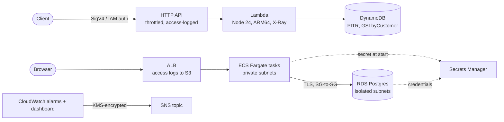

# orders-platform-cdk

A small, production-shaped AWS platform written in **CDK (TypeScript)**, built to be explained line by line in an
interview for an "AWS DevOps – CDK TypeScript" role. It is deliberately tight: one idea per file, every decision
commented with _why_, _what else I could have used_, and _the trade-off_.

> **Honest framing for interviews:** this is a personal reference project built to practise the JD's stack. Say that.
> Your production evidence is the Lambda→ECS migration, DynamoDB/SQS work, CDK in real services and the CodeBuild/CodeArtifact
> pipeline debugging. This project is how you show you can extend that into a full DevOps shape: reusable constructs,
> policy-as-code, OIDC pipelines and security gates. Never claim you ran it in production.

---

## 1. What it builds



Two stacks per stage, split by **change frequency and risk**:

| Stack                              | Contains                                              | Why separate                                                                 |
| ---------------------------------- | ----------------------------------------------------- | ---------------------------------------------------------------------------- |
| `orders-<stage>-foundation`        | VPC, RDS, DynamoDB, KMS key, SNS alarm topic          | Stateful. Termination protection + RETAIN in prod. Rarely changes.           |
| `orders-<stage>-app`               | HTTP API, Lambda, ECS service, ALB, alarms, dashboard | Stateless. Deployed on every merge. Safe to roll back or recreate.           |
| `orders-github-oidc` (own CDK app) | GitHub OIDC provider + 2 CI roles                     | Deployed once by a human; the pipeline can never change its own permissions. |

Size: ~1,000 lines of TypeScript (excluding comments) → ~90–95 CloudFormation resources per stage.

---

## 2. JD requirement → where to find it

| JD requirement                                                  | Where                                                              | Talking point                                                   |
| --------------------------------------------------------------- | ------------------------------------------------------------------ | --------------------------------------------------------------- |
| CDK + TypeScript, reusable constructs, stacks                   | `lib/constructs/*`, `lib/stacks/*`                                 | L2 vs L3 wrappers; `SecureBucket` is a platform-team construct  |
| Deployment frameworks / multi-env                               | `lib/config.ts`, `lib/platform.ts`, `bin/app.ts`                   | One typed config; stage chosen by context; unknown stage throws |
| IaC with CDK **and** CloudFormation                             | `cdk synth` output; OIDC stack                                     | CDK compiles to CloudFormation; `cdk diff` = change set preview |
| IaC with Terraform                                              | `docs/TERRAFORM_BRIDGE.md`                                         | Honest mapping CDK↔Terraform and where the bridge ends          |
| CI/CD (GitHub Actions)                                          | `.github/workflows/ci.yml`, `deploy.yml`                           | OIDC, environments, approvals, concurrency, rollback            |
| CDK deployed from CI with security/quality/vulnerability checks | `ci.yml` jobs                                                      | SCA, secrets, SAST, IaC scan, image scan, cdk-nag, tests        |
| Policy-as-code                                                  | cdk-nag in `lib/platform.ts`; `lib/aspects/lambda-guardrails.ts`   | Aspect vs cdk-nag vs SCP                                        |
| Lambda, API Gateway                                             | `lib/constructs/orders-api.ts`                                     | HTTP vs REST API; least-privilege IAM; throttling               |
| ECS (and EKS trade-off)                                         | `lib/constructs/web-service.ts`                                    | Fargate vs EC2 vs EKS; circuit breaker; zero-downtime deploys   |
| RDS                                                             | `lib/constructs/postgres-database.ts`                              | Multi-AZ, rotation gotcha, isolated subnets, RDS vs Aurora      |
| DynamoDB                                                        | `lib/stacks/foundation-stack.ts`, `app/orders-api/src/handler.ts`  | Single table + GSI, on-demand, PITR                             |
| S3                                                              | `lib/constructs/secure-bucket.ts`                                  | Guardrail defaults; SSE-S3 required for ALB logs                |
| EC2                                                             | _Not built_ (see §7)                                               | Say so; explain the ECS-on-EC2 / bastion alternative            |
| CloudWatch monitoring, logging                                  | alarms in every construct, `app-stack.ts` dashboard                | Symptom-based alarms; missing data ≠ outage                     |
| Security controls                                               | SG design, KMS, flow logs, TLS-only, no secrets in env             | Defence in depth at each layer                                  |
| Operational automation                                          | autoscaling, secret rotation, storage autoscaling, circuit breaker | Automation that removes pager events                            |
| Enterprise scale                                                | tags, stateful/stateless split, OIDC roles, config per stage       | Extension path: Organizations, SCPs, CDK Pipelines              |

---

## 3. Quickstart

Requires Node 22+ (`.nvmrc`), an AWS account, and (for the container build) Docker.

```bash
npm ci
npm run build          # type-check
npm test               # 64 tests, includes full-app synth through cdk-nag
```

Synthesize **without AWS credentials** (this is what CI does):

```bash
CDK_DEFAULT_ACCOUNT=123456789012 CDK_OUTDIR=cdk.out CDK_CONTEXT_JSON='{"stage":"dev"}' npx tsx bin/app.ts
```

### Deploy to your account (about 40 minutes, dev stage)

```bash
# 0. credentials for your account (SSO profile or env vars), then:
export AWS_REGION=ap-south-1

# 1. One-time: bootstrap CDK (creates the deploy/publishing/lookup roles and the asset buckets/repo)
npx cdk bootstrap aws://<ACCOUNT_ID>/ap-south-1

# 2. Deploy dev (VPC + RDS take ~15 min; the NAT gateway starts billing now)
npx cdk deploy --all -c stage=dev
#    Optional: ALARM_EMAIL=you@example.com npx cdk deploy --all -c stage=dev   (confirm the SNS subscription email)

# 3. Try it
WEB=$(aws cloudformation describe-stacks --stack-name orders-dev-app --query "Stacks[0].Outputs[?OutputKey=='WebUrl'].OutputValue" --output text)
curl "$WEB/health"          # {"status":"ok"}
curl "$WEB/db-check"        # proves ECS -> RDS over verified TLS

API=$(aws cloudformation describe-stacks --stack-name orders-dev-app --query "Stacks[0].Outputs[?OutputKey=='ApiUrl'].OutputValue" --output text)
pip install awscurl         # the API uses IAM (SigV4) auth, so plain curl gets 403
awscurl --service execute-api --region ap-south-1 -X POST "${API}orders" \
  -d '{"customerId":"c-1","items":[{"sku":"ABC","quantity":2}]}'
awscurl --service execute-api --region ap-south-1 "${API}customers/c-1/orders"

# 4. TEAR DOWN when done (NAT gateway + RDS cost money every hour they exist)
npx cdk destroy --all -c stage=dev
```

### Wire up the pipeline (GitHub Actions + OIDC)

```bash
# One-time, by a human. Creates the OIDC provider and the two least-privilege roles.
npx cdk deploy -a "npx tsx bin/github-oidc.ts" -c githubOwner=<owner> -c githubRepo=<repo>
#   If your account already has the GitHub provider, add: -c existingProviderArn=arn:aws:iam::<acct>:oidc-provider/token.actions.githubusercontent.com
```

In GitHub → Settings:

1. **Variables** (repo): `AWS_DEPLOY_ROLE_ARN`, `AWS_DIFF_ROLE_ARN` (stack outputs), optional `ALARM_EMAIL`, `WEB_CERTIFICATE_ARN`.
2. **Environments**: create `dev` and `prod`. On `prod`, add **required reviewers** (this is the manual approval gate).
3. Branch protection on `main`: require the `ci` checks and a review.

---

## 4. The pipeline (security gates)

```
PR:   quality ─ sca ─ secrets ─ sast ─ iac-scan ─ container-scan ─ cdk-diff (read-only role)
main: [all of the above] → deploy dev → smoke test → ⏸ manual approval → cdk diff → deploy prod → smoke test
```

| Gate                    | Tool                                                          | Catches                                                                      |
| ----------------------- | ------------------------------------------------------------- | ---------------------------------------------------------------------------- |
| Type-check + unit tests | `tsc`, Jest                                                   | Logic and invariant regressions (assertions, not snapshots)                  |
| Policy-as-code at synth | **cdk-nag** (AwsSolutions) + custom `LambdaGuardrails` Aspect | Unencrypted/public resources, wildcard IAM, missing logs. `synth` **fails**. |
| SCA                     | `npm audit` (+ Dependabot)                                    | Vulnerable dependencies                                                      |
| Secrets                 | gitleaks (full history)                                       | Committed credentials                                                        |
| SAST                    | Semgrep                                                       | Injection, unsafe patterns in our code                                       |
| IaC scan                | Checkov on synthesized templates                              | 2nd rule set; sees the final template                                        |
| Image scan              | Trivy                                                         | Fixable HIGH/CRITICAL CVEs in the image                                      |
| Auth                    | GitHub OIDC, `sub` pinned to repo + environment               | No stored keys; only the protected environments can deploy                   |

Every accepted risk is an explicit, reasoned exception: `Validations.of(x).acknowledge({ id, reason })` for cdk-nag and
`.checkov.yaml` for Checkov. **No unexplained suppressions.**

---

## 5. Design decisions and alternatives

| Decision                                | Alternatives                                     | Why this, and the trade-off                                                                                            |
| --------------------------------------- | ------------------------------------------------ | ---------------------------------------------------------------------------------------------------------------------- |
| Two stacks (stateful / stateless)       | One stack; many micro-stacks                     | Blast radius and deploy speed. Cost: cross-stack references (exports) are sticky.                                      |
| L2 constructs + a few L3-style wrappers | L3 patterns everywhere; raw L1                   | L2 gives control; wrappers encode org defaults. L3 patterns hide SG/listener wiring.                                   |
| ECS Fargate                             | Lambda, ECS on EC2, EKS                          | Steady DB-connected service. EKS adds a control plane and upgrade work you only want for the K8s ecosystem.            |
| RDS Postgres                            | Aurora, DynamoDB only                            | Cheaper to run at this size. Aurora when you need fast failover or many read replicas.                                 |
| HTTP API + IAM auth                     | REST API; Cognito/Okta JWT                       | Cheaper/faster. REST needed for usage plans, WAF, request models. JWT for end users.                                   |
| GitHub Actions + OIDC                   | CDK Pipelines/CodePipeline; Jenkins              | Code, review and scanning already in GitHub. CDK Pipelines when AWS-native or cross-account tools-account is mandated. |
| cdk-nag + Checkov                       | cdk-nag only; OPA/Conftest; CloudFormation Guard | Two rule sets; Checkov reads the final template.                                                                       |
| Assertion tests                         | Snapshot tests                                   | Assertions fail only when a real invariant breaks.                                                                     |
| NAT gateway for egress                  | VPC interface endpoints (ECR, Logs, STS)         | Cheaper at 1–2 tasks. Endpoints win at scale or under "no internet egress" rules.                                      |
| Secrets as ECS `secrets`                | Env vars; SDK fetch in app                       | Never in the task definition JSON. Caveat: rotation needs new tasks (or IAM auth).                                     |
| `fromAsset` image build in CDK          | Build/scan/push in CI, deploy by tag             | Self-contained here. Real pipelines should scan the _exact_ image they ship.                                           |
| X86 Fargate, ARM Lambda                 | ARM everywhere                                   | x86 builds natively on GitHub runners; ARM64 images need buildx/QEMU. Next optimization.                               |

### Gotchas this project hit (good interview stories)

1. **Cross-stack dependency cycle.** `db.connections.allowDefaultPortFrom(service)` put the rule in the _database's_ stack,
   which referenced the service SG in the _app_ stack, while the app stack already depended on foundation → cycle.
   Fix: import the DB security group **by ID inside the consumer stack** and add the rules there (`web-service.ts`).
2. **cdk-nag v3 is a different API.** It now plugs into CDK's native policy validation (`Validations.of(app).addPlugins(...)`),
   suppressions are `Validations.of(x).acknowledge(...)`, and violations make `synth` throw. Most tutorials still show the v2 Aspect/`NagSuppressions` API.
3. **SNS + CloudWatch + KMS.** Alarms cannot publish to a topic encrypted with `alias/aws/sns`; a customer-managed key whose policy trusts
   `cloudwatch.amazonaws.com` is required, otherwise notifications are silently dropped (`alarm-topic.ts`).
4. **Secret rotation inside isolated subnets** needs a Secrets Manager VPC endpoint or it fails 30 days after deploy (`network.ts`).
5. **`table.grant()` adds `index/*`.** Granting exact actions on exact ARNs avoids a wildcard that cdk-nag flags (`orders-api.ts`).
6. **Where an acknowledgement goes matters.** `instance.secret` is the secret _attachment_ (a child of the Secret), so acknowledging there did not cover the flagged `CfnSecret`. Acknowledge on an _ancestor_ of the flagged resource (`postgres-database.ts`).

---

## 6. Day-by-day plan (you have ~2 days before drilling)

The code is written. Your 2 days are for **owning it**, not typing it.

**Day 1: run it and read it (≈6–7 h)**

- 1 h: read this README, then `lib/platform.ts` → `lib/config.ts` → `bin/app.ts` (the composition root).
- 2 h: read the five constructs in this order: `network` → `postgres-database` → `orders-api` → `web-service` → `alarm-topic`. For each, say out loud: _what, why, alternative, trade-off._
- 1 h: `npm ci && npm test`; open one synthesized template and find: the SG rules, the IAM policy, the circuit breaker.
- 2 h: deploy dev (§3), hit every endpoint, open the CloudWatch dashboard, **destroy**.

**Day 2: pipeline and break-it drills (≈6–7 h)**

- 2 h: push to your own GitHub repo, deploy the OIDC stack, configure variables/environments, watch `ci` run green.
- 3 h: break it on purpose and explain what failed and why:
  1. Delete `enforceSSL` in `secure-bucket.ts` → cdk-nag fails `synth`.
  2. Change the OIDC `sub` to `repo:other/other:*` → `AccessDenied` on `AssumeRoleWithWebIdentity`.
  3. Rename the `Database` construct ID → run `cdk diff` and read the **replacement** (why stateful IDs are sacred).
  4. Remove `tracing` from the Lambda → the custom Aspect fails `synth`.
  5. Make the container fail `/health` → watch the circuit breaker roll back.
- 1 h: read `docs/INTERVIEW_QA.md` aloud and time yourself (target 60–90 s per answer).

---

## 7. What this does NOT cover (say so; don't hide it)

- **EC2 and EKS**: not built. Be ready to describe ECS-on-EC2 (capacity providers, ASG, AMI patching) and EKS (control plane, node groups/Fargate profiles, IRSA, add-ons). Your Docker/K8s practice covers concepts, not production EKS.
- **Terraform**: not deployed here. `docs/TERRAFORM_BRIDGE.md` maps the concepts and shows the equivalent module.
- **End-user auth** (Cognito/Okta JWT), **WAF**, **Route 53/ACM** (HTTPS needs `WEB_CERTIFICATE_ARN`), **multi-account** (Organizations, SCPs, per-stage accounts), **cross-region DR**.
- **Blue/green with CodeDeploy**: rolling deploy + circuit breaker used instead (noted in `web-service.ts`).

## 8. What was verified when this was written

| Verified (ran it)                                                                                    | Not verified (be aware)                                                                                                                          |
| ---------------------------------------------------------------------------------------------------- | ------------------------------------------------------------------------------------------------------------------------------------------------ |
| `tsc` strict type-check passes                                                                       | An actual deploy to AWS (no AWS credentials in the build environment)                                                                            |
| 64 Jest tests pass, incl. full synth of both stages and the OIDC app through cdk-nag + custom Aspect | `docker build` of `app/web/Dockerfile` (no Docker daemon available)                                                                              |
| Both stages and the OIDC app synthesize with 0 cdk-nag violations                                    | Semgrep, gitleaks and Trivy jobs (registry/image access blocked in the build environment)                                                        |
| Checkov: 0 failures on both stages and the OIDC app (with documented skips)                          | `cdk diff` via the read-only role (the lookup role's exact read scope is `[POSSIBLE]` to need tweaking)                                          |
| `actionlint` clean on both workflows; YAML parses                                                    | GitHub Action major versions (`checkout@v6`, `setup-node@v6`, `configure-aws-credentials@v6`, `setup-python@v6`): confirm before relying on them |
| `npm audit`: 0 vulnerabilities (both package.json files)                                             | Cost figures in comments (NAT ≈ $32/mo, interface endpoint ≈ $7/AZ/mo, EKS control plane ≈ $73/mo) are approximate; check the AWS pricing page   |

Expect small fixes on the first real deploy (a quota, a region-specific service name, an IAM edge). **Fixing them is the best
interview material you can get.** Write down each one.

## 9. Cost and safety

Dev costs a few dollars per day while up (NAT gateway, RDS, ALB, Fargate task are the main items). **Run `npx cdk destroy --all -c stage=dev`
when done.** If `autoDeleteObjects` or a retained log group leaves something behind, delete it in the console. Set an AWS Budget alert before you deploy.
